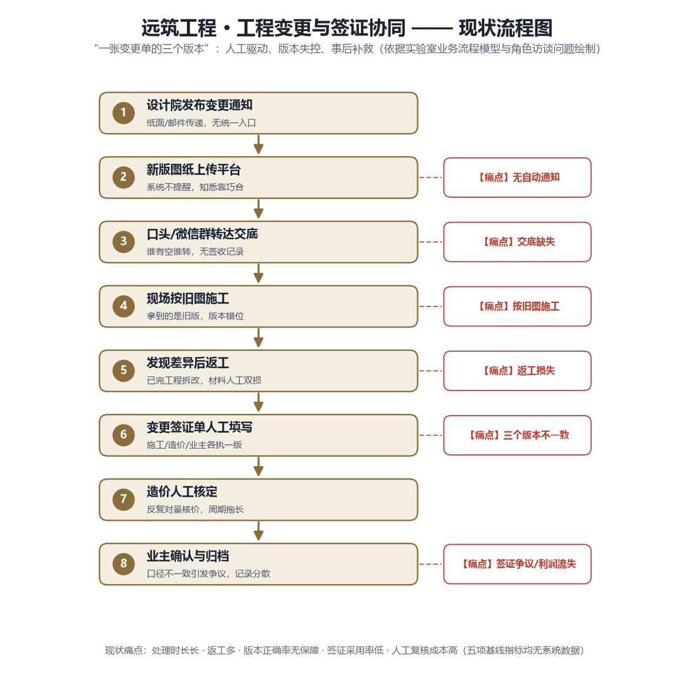
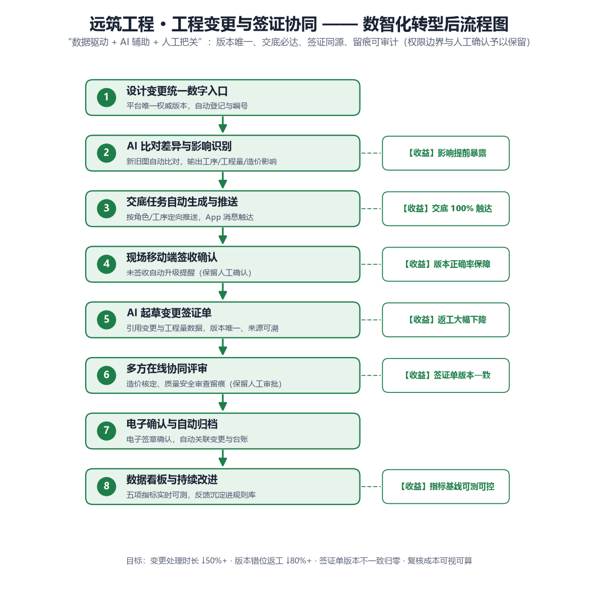

<div align="center">

# 🏗️ 工程变更与签证协同平台

**版本唯一 · 交底必达 · 签证同源 · 留痕可审计**

面向建筑工程「工程变更与签证」场景的数智化协同系统，内置领域 AI 智能体


</div>

---

## 📖 一句话说明

> 现场拿到旧图施工、新图没人交底、签证单三个版本对不上——这三个"扯皮"根源，本系统用**统一变更台账 + 定向交底签收 + 签证同源 + AI 助手**一次性收口。

系统不是一份 PPT 方案，而是**可运行的系统**：7 个业务页面 + 10 个智能体工具 + 状态机强制流转 + 决策日志审计，本地一条命令启动即可体验完整闭环。

## 🔥 解决的三个真问题

| 行业痛点 | 后果 | 系统解法 |
| --- | --- | --- |
| **版本失控**：变更单在微信/邮件/纸质间流转，现场按旧图施工 | 返工、拆改、工期损失 | 变更台账唯一版本源，发布新版即自动作废旧版，版本时间线全程留痕 |
| **交底缺失**：新版本无人逐一通知，签收无凭据 | 事后扯皮、责任不清 | 交底中心按角色定向推送，逐人签收，全员签收才进入待签证 |
| **签证争议**：签证单与变更版本脱节，金额口径不一 | 结算被砍、审计不过 | 签证单锁定来源变更版本，AI 起草 + 造价核定 + 业主确认，AI 结论必须人工确认 |

## ✨ 功能矩阵（均为已实现）

| 模块 | 页面能力 | 状态 |
| --- | --- | --- |
| 🏠 **工作台** | 4 项 KPI（在办变更 / 待签收交底 / 待处理签证 / 平均处理时长）+ 我的待办（一键签收、一键核价）+ 流程健康度 | ✅ 可运行 |
| 📋 **变更台账** | 变更登记、筛选检索、详情抽屉、版本时间线（现行 / 已作废）、发布新版本、归档 | ✅ 可运行 |
| 📢 **交底中心** | 按角色定向交底、签收留痕、签收率进度、全部签收自动流转至待签证 | ✅ 可运行 |
| 💰 **签证协同** | 与变更同源（锁定来源版本）、金额与工程量登记、造价核价 → 业主确认 → 生效、AI 起草标记 | ✅ 可运行 |
| 📊 **数据看板** | 五项基线指标（处理时长 / 交底签收率 / 版本正确率 / 返工率 / 复核成本）+ 7 日趋势 + 分类分布 | ✅ 可运行 |
| 🤖 **AI 协同助手** | 流式对话、检索制度条款并标注出处、查询变更/签证状态、起草签证草稿（强制人工确认） | ✅ 可运行 |
| 🔐 **管理后台** | 知识库管理（上传/切片/删除）、提示词模板管理（存库即时生效）、对话审计（违规标红） | ✅ 可运行 |

### 状态机（服务端强制，不可绕过）

```
变更单：在建 ──发布新版本──> 交底中 ──全员签收──> 待签证 ──造价核价──> 待业主确认 ──业主确认──> 已确认
                                                                              └──驳回──> 已驳回
签证单：待核定 ──核价──> 待业主确认 ──确认──> 已确认
          └────────── 驳回 ──────────> 已驳回
```

## 🤖 智能体设计（业务系统之上的能力层）

不是"套壳聊天"，而是**有工具、有状态、有人工闸门**的领域智能体。

| 层 | 实现 |
| --- | --- |
| **领域工具（3）** | `query_changes` 台账检索 · `get_change_detail` 变更详情与交底/签证状态 · `draft_visa` 起草签证（只起草，不核定） |
| **辅助工具（7）** | 现场费用报销：`search_policy` / `get_expense_standard` / `validate_expense` / `create_draft` / `update_draft` / `get_my_drafts` / `submit_draft` |
| **编排循环** | 自研 Agent Harness，最多 5 轮，逐轮落库决策日志（工具 / 参数 / 耗时 / 结果 / 轮次 / 状态） |
| **人工闸门 HITL** | `draft_visa`、`create_draft` 强制中断确认，确认后恢复执行，取消则自动善后，快照落 `pending_actions` |
| **调用约束** | 系统提示词约束 + 服务端 ticket 状态机（10 分钟有效、金额篡改即失效），跳过校验的请求直接被拦截 |
| **可测性** | [`tests/evaluation_cases.json`](tests/evaluation_cases.json) 30 条评测用例：制度类 / 工具调用类 / 违规意图类 / 多轮上下文类 |

**典型对话**

```
你：CH-2026-0002 现在什么状态？交底签收了吗
AI：[get_change_detail] → 该变更当前为 V2 版本，处于「交底中」，
    造价负责人、质量负责人尚未签收，全员签收后方可进入签证流程

你：帮我为 CH-2026-0004 起草签证单，金额 15800 元，120m 临时道路硬化
AI：[query_changes] → [get_change_detail] → [draft_visa]
    → 已生成 VZ-2026-0004（草稿，来源版本 V1 已锁定）
    → ⏸ 金额需人工核定后才生效，请确认
```

## 🚀 快速开始

```bash
pip install -r requirements.txt
cp .env.example .env          # 填入 RAG_API_KEY（DeepSeek 等 OpenAI 兼容供应商）
uvicorn app.main:app --port 8000
```

打开 **http://127.0.0.1:8000** → 注册即用（首个注册用户自动成为管理员）。

| 演示账号 | 密码 | 角色 |
| --- | --- | --- |
| `zhangsan` | `abc123456` | 管理员 |

> 未配置 LLM Key 也可运行：检索问答自动降级为纯 BM25，业务模块全部可用。

**首次启动自动完成**：建表 → 播种 5 个演示变更（含案例「三层梁柱节点钢筋代换」三版本故事）→ 播种 3 张签证单 → 播种默认提示词模板。

## 📡 主要接口

| 方法 | 路径 | 说明 |
| --- | --- | --- |
| POST | `/api/auth/register` · `/api/auth/login` · GET `/api/auth/me` | JWT 认证 |
| GET | `/api/projects` | 项目列表 |
| GET/POST | `/api/changes` | 变更台账 / 变更登记 |
| GET | `/api/changes/{id}` | 变更详情（含版本时间线、交底、签证） |
| POST | `/api/changes/{id}/versions` | 发布新版本（旧版自动作废） |
| POST | `/api/changes/{id}/archive` | 变更归档 |
| GET | `/api/briefings` · POST `/api/briefings/{id}/sign` | 交底列表 / 签收 |
| GET/POST | `/api/visas` · POST `/api/visas/{id}/review` | 签证列表 / 登记 / 核定确认 |
| GET | `/api/dashboard` | 看板指标与趋势 |
| POST | `/api/chat/stream` · `/api/chat/confirm` | AI 流式对话（SSE）/ 人工确认后恢复 |
| GET/PUT | `/api/admin/prompts` · GET `/api/admin/traces` | 提示词模板 / 对话审计 |
| GET/POST/DELETE | `/api/knowledge/documents` | 知识库管理 |

完整文档：**http://127.0.0.1:8000/docs**

## 📁 目录结构

```
app/
├── main.py                  入口：建表 + 播种 + 路由挂载 + 静态页托管
├── core/                    配置 / JWT / 依赖 / 数据库 / 演示数据播种
├── models/
│   ├── change.py            Project · ChangeOrder · ChangeVersion · Briefing · VisaOrder
│   ├── agent.py             agent_step_logs（决策日志）· pending_actions（HITL 快照）
│   └── user/chat/policy/prompt/expense
├── api/
│   ├── construction.py      变更 / 版本 / 交底 / 签证 / 看板
│   ├── chat.py              SSE 流式对话 + 人工确认恢复
│   ├── knowledge.py         知识库上传 / 切片 / 删除
│   ├── admin.py             提示词模板 + 对话审计
│   └── auth.py              JWT 注册 / 登录
├── agent/
│   ├── registry.py          10 工具注册表 + ticket 状态机 + 违规关键词
│   ├── harness.py           编排循环（5 轮）+ HITL 中断 / 恢复 + 决策日志
│   ├── prompts/             agent / qa / expense 默认提示词（DB 优先）
│   └── llm/client.py        OpenAI 兼容适配（同步 / 流式 / Embedding）
├── rag/retriever.py         BM25 + 向量混合检索（RRF 融合），支持 PDF
└── static/index.html        全中文单页应用（7 个视图，SSE 打字机）
docs/
├── construction-change/     项目交付物 6 件套（业务挖掘 / 行业分析 / 流程图 / 报价 / 设计方案）
└── 01~08                    研发文档（需求评审 → 架构 → 原型 → Agent → 编排 → 上线检查）
prototype/rag_prototype.py   阶段 1 单脚本 RAG 原型
tests/                       冒烟测试 8 条 + 评测用例 30 条
```

## 📚 文档导航

**① 项目交付物**（[`docs/construction-change/`](docs/construction-change/)）

| 交付物 | 说明 |
| --- | --- |
| 📄 [业务挖掘报告](docs/construction-change/01-业务挖掘报告.md) | 触发事件 · 5 项业务机会 · 指标基线 · 六角色利益相关者地图 |
| 📊 [行业分析](docs/construction-change/02-行业分析.docx) | 政策背景 · 四大共性痛点 · 技术成熟度 · 对项目的启示（Word） |
| 💰 [报价单](docs/construction-change/05-报价单.xlsx) | 首期试点 3 个月打包价 ¥286,000，9 项明细，公式自动合计（Excel） |
| 📐 [设计方案](docs/construction-change/06-设计方案.docx) | 四层架构 · 五大模块 · AI 红线 · 九阶段实施计划（Word） |

**② 流程图**

| 现状（8 步人工流程，6 处痛点） | 数智化转型后（8 步协同流程，6 项收益） |
| --- | --- |
|  |  |

**③ 研发文档**

| 文档 | 说明 |
| --- | --- |
| [需求评审十问](docs/01-需求评审十问与决策.md) | 10 个关键问题与决策记录 |
| [技术架构方案](docs/02-技术架构方案.md) | 四层架构 · 六张表 · 首周验证目标 |
| [裸问答原型](docs/03-裸问答原型说明.md) | 500 字切片 + 混合检索 + LLM 封装 |
| [Agent 工具与调用约束](docs/04-Agent工具与调用约束设计.md) | 工具契约与调用顺序约束 |
| [管理后台实现](docs/05-管理后台实现说明.md) | JWT 双角色 · 知识库 · 提示词 · 审计 |
| [Agent 与编排实现](docs/06-Agent实现说明.md) · [07-Agent编排](docs/07-Agent编排实现说明.md) | Harness 循环 · 决策日志 · HITL 轨迹 |
| [上线检查清单](docs/08-上线检查清单.md) | 5 维度 × 5 项，14 项必过 + Go/No-Go 规则 |

## 🧪 测试

```bash
python -m pytest tests/test_smoke.py -v     # 冒烟测试 8 条（无需 API Key）
python -c "import json;print(len(json.load(open('tests/evaluation_cases.json',encoding='utf-8'))))"   # 30
```

## ⚙️ 环境变量

| 变量 | 说明 | 默认 |
| --- | --- | --- |
| `RAG_API_KEY` | 对话模型 API Key | -（缺失时降级 BM25） |
| `RAG_BASE_URL` / `RAG_MODEL` | 对话模型供应商与模型 | DeepSeek / `deepseek-chat` |
| `EMBED_API_KEY` / `EMBED_BASE_URL` / `EMBED_MODEL` | Embedding 供应商 | 千问 / `text-embedding-v3` |
| `APP_DATABASE_URL` | 数据库连接 | SQLite（开发）/ PostgreSQL + pgvector（生产） |

## 🗺️ 路线图

```
✅ 工程变更业务模块（台账 / 版本 / 交底 / 签证 / 看板，7 页面可运行）
✅ 领域智能体（10 工具 + Harness 5 轮 + HITL 人工闸门 + 决策日志）
✅ 企业管理后台（知识库 / 提示词 / 审计）
✅ 项目交付物 6 件套 + 评测用例 30 条 + 上线检查 25 项
⬜ 图纸差异 AI 比对（BIM / PDF 叠图）
⬜ 工程量清单自动提取与造价联动
⬜ 多项目租户隔离与移动端签收
```

---

<div align="center">

*合成业务场景说明：项目数据基于 FDE 实验室合成样本，企业与人员均为虚构，真实业务验收需另行核实*

</div>
